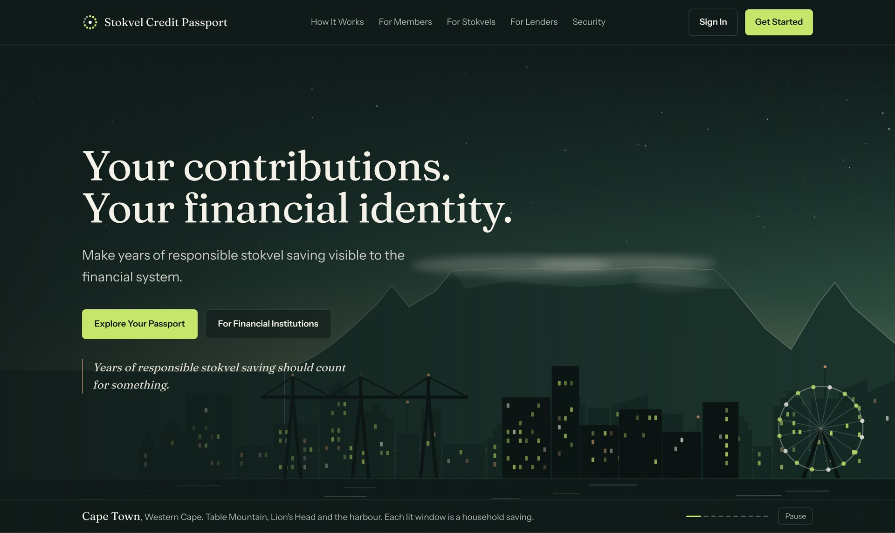
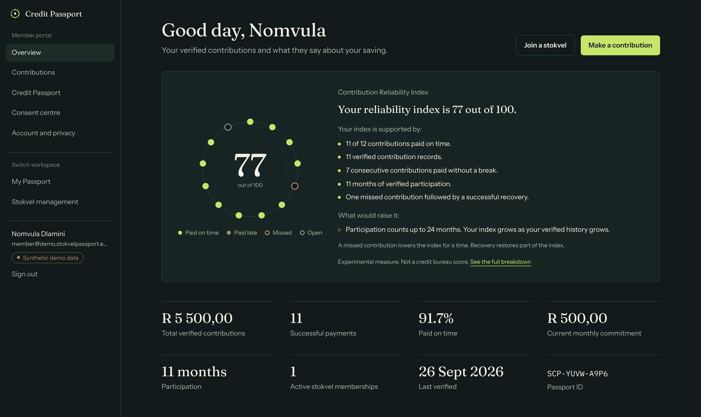
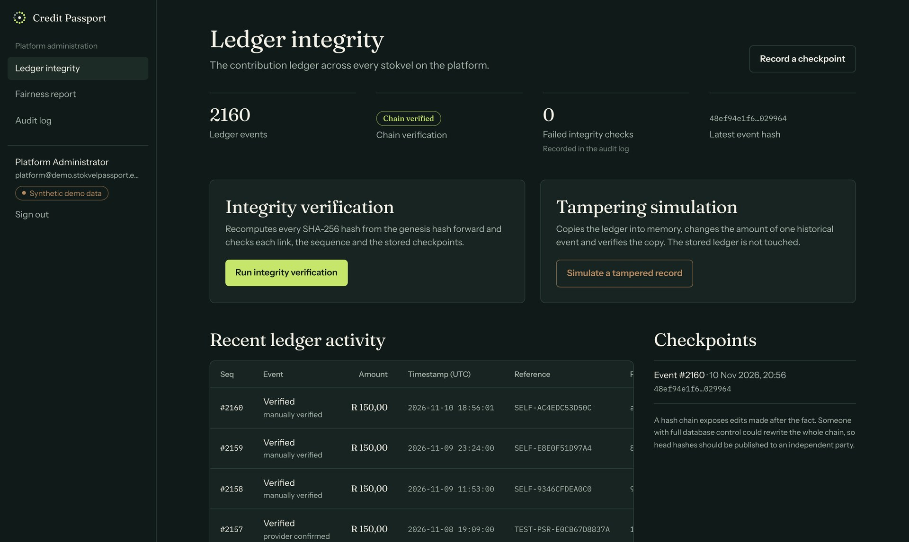

<div align="center">

# Stokvel Credit Passport

**Your contributions. Your financial identity.**

<a href="https://stokvel-credit-passport.netlify.app"></a>
<a href="docs/DEMO.md"></a>

<a href="https://github.com/Don4chnge/stokvel-credit-passport/actions/workflows/ci.yml"></a>


Designed and built by **Thabang Manyama**

<a href="https://stokvel-credit-passport.netlify.app"></a>

</div>

Sign in to the [live demo](https://stokvel-credit-passport.netlify.app) as a member with
`member@demo.stokvelpassport.example` and the password `Passport-Demo-2026`. The first request can take up
to a minute while the free API host wakes up.

| Member overview | Ledger integrity |
| --- | --- |
|  |  |

A working prototype of a financial identity platform for South African stokvel members. It turns verified
stokvel contribution behaviour into a portable, transparent record that the member owns and controls.

> **Status: prototype.** All data is synthetic. Payments run in TEST MODE and move no money. There are no
> partners, pilots, real users or regulatory approvals. The Contribution Reliability Index is experimental.
> It is not a credit bureau score and it does not guarantee credit approval.

## What it does

1. A stokvel registers its group, amount and schedule.
2. Members join and pay by PayShap Request (simulated) or record a payment made another way.
3. The payment provider confirms the payment, or the treasurer verifies it by hand. A screenshot or a
   member's own entry is never enough.
4. Every verified contribution joins a SHA-256 hash-chained, append-only ledger.
5. A transparent rule-based model calculates a Contribution Reliability Index (0 to 100) with a plain
   explanation.
6. The member generates a Credit Passport (screen and PDF, with a QR authenticity check).
7. The member shares it with a lender through a time-limited, revocable link that shows only chosen fields.
8. The lender verifies the Passport. Every access is logged and visible to the member.

## What is in the box

| Area | Contents |
| --- | --- |
| Public website | Animated hero that moves by itself through drawn skylines of ten South African cities, privacy, terms, refund and cookie policies, cookie banner, problem, five-step journey, sample Passport, live in-browser hash-chain demo, consent, lender section, FAQ, pilot registration, legal pages |
| Member portal | Overview with the contribution ring, contributions (pay, record, report a problem), Passport and PDF, consent centre, account and privacy |
| Stokvel management | Group overview, review queue, contribution calendar and reconciliation, members and roles, ledger with integrity check and tampering simulation |
| Lender portal | Open a shared Passport, scoped view, provenance, report download, verification history |
| Platform administration | Ledger status, checkpoints, tampering simulation, fairness report, audit log |
| Backend | FastAPI, SQLAlchemy, PostgreSQL or SQLite, Alembic migration, 47 documented endpoints |
| Tests | 169 backend tests, 21 frontend unit tests, 73 Playwright end-to-end tests including security and WCAG 2.1 AA checks, GitHub Actions CI |

## Run it locally

Requirements: Python 3.12 or newer, Node.js 20 or newer.

```bash
# 1. API with synthetic data (SQLite by default)
cd backend
python -m venv .venv && source .venv/bin/activate
pip install -r requirements-dev.txt
python -m app.seed --reset          # creates 5 stokvels, 108 members, 12 to 24 months of history
uvicorn app.main:app --port 8000

# 2. Website, in a second terminal
cd frontend
npm install
npm run build && npm start          # or: npm run dev
```

Open http://localhost:3000. API documentation: http://localhost:3000/api/docs

To use PostgreSQL, set `DATABASE_URL` and run `alembic upgrade head` before seeding. See
[docs/DEPLOYMENT.md](docs/DEPLOYMENT.md).

## Demo accounts (synthetic)

Password for every demo account: `Passport-Demo-2026`

| Role | Email | Lands on |
| --- | --- | --- |
| Member | member@demo.stokvelpassport.example | Member portal |
| Treasurer | treasurer@demo.stokvelpassport.example | Member portal, then Stokvel management |
| Stokvel administrator | admin@demo.stokvelpassport.example | Member portal, then Stokvel management |
| Lender | lender@demo.stokvelpassport.example | Lender portal |
| Platform administrator | platform@demo.stokvelpassport.example | Platform administration |

These exist only in seeded demo databases. Never seed a production database that holds real members.
The 16-step demo script is in [docs/DEMO.md](docs/DEMO.md).

## Run the tests

```bash
cd backend && pytest -q                                   # 169 tests on SQLite
TEST_DATABASE_URL=postgresql://... pytest -q              # the same tests on PostgreSQL
cd frontend && npm run lint && npm test                   # types and 21 unit tests
cd frontend && npm run build && npm run e2e               # 73 Playwright tests (starts both servers)
```

Results from the last full run are recorded in [docs/TEST_REPORT.md](docs/TEST_REPORT.md).

## Documentation

- [Architecture, database and trust assumptions](docs/ARCHITECTURE.md)
- [API examples](docs/API.md)
- [Payments and how to activate a real PayShap provider](docs/PAYMENTS.md)
- [Contribution Reliability Index and fairness](docs/SCORING.md)
- [Security checklist: 20 points, findings and tests](docs/SECURITY_CHECKLIST.md)
- [Security and POPIA design notes](docs/SECURITY.md)
- [Product analytics plan (PostHog)](docs/ANALYTICS.md)
- [Launch checklist: 20 compliance points and their tests](docs/COMPLIANCE.md)
- [Legal review checklist](docs/LEGAL_REVIEW_CHECKLIST.md)
- [Deployment: Neon, Render, Netlify or Vercel](docs/DEPLOYMENT.md)
- [Research notes and sources](docs/RESEARCH.md)

## What needs an account or a decision from you

| Item | Status | What activates it |
| --- | --- | --- |
| Live PayShap Request | TEST MODE only | A merchant account and API credentials from an authorised provider such as Stitch or Ozow. See docs/PAYMENTS.md |
| PostHog analytics | Built, switched off | `NEXT_PUBLIC_POSTHOG_KEY` and `NEXT_PUBLIC_POSTHOG_HOST` |
| Hosted deployment | Live demo with synthetic data | Database on Neon, API on Render, website on Netlify. See docs/DEPLOYMENT.md |
| Real pilot data | None | One or two stokvels that agree to a pilot, after legal review |
| Legal position | Not reviewed | docs/LEGAL_REVIEW_CHECKLIST.md |
